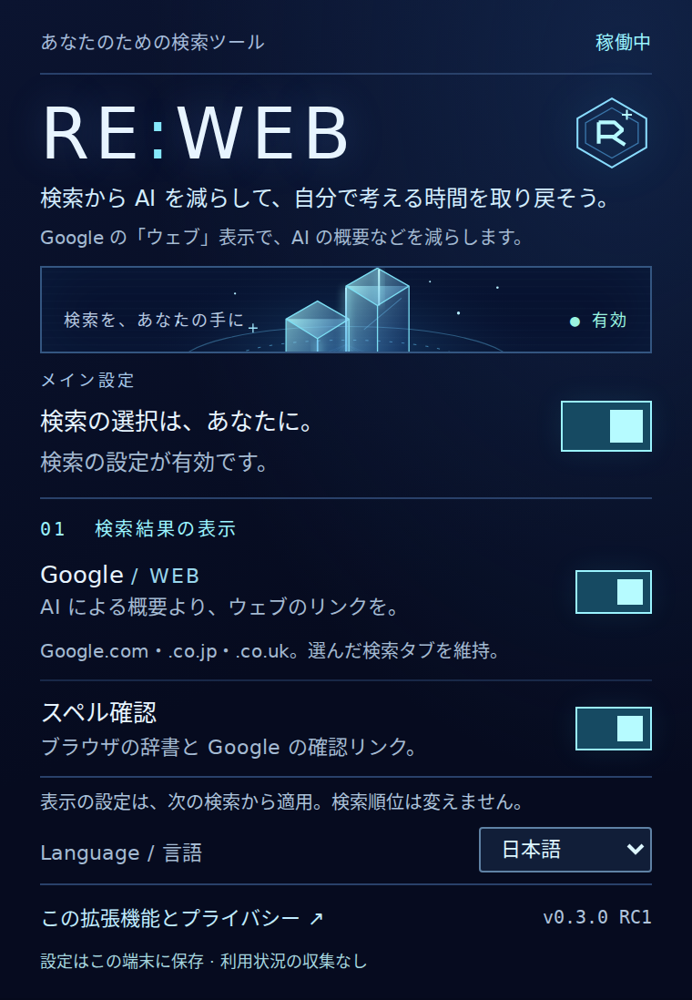

# RE:WEB

**検索から AI を減らして、自分で考える時間を取り戻そう。**

Google の「ウェブ」フィルタで、AI による概要などの表示を減らす、小さな無料のブラウザ拡張機能です。PS2 をイメージした独自の画面、一時停止スイッチ、スペル確認機能を備えています。

[English](README.md) · [詳しいインストール手順（英語）](docs/INSTALL.md)

**0.3.0 RC1：開発用のリリース候補です。** ストアで署名・承認された製品ではありません。GitHub Actions で実ブラウザのインストール・API テストが通過しました（Chrome 52 件、Firefox 43 件）。Google の実ページとブラウザの辞書による確認は、まだ手動での検証が必要です。[テスト結果](docs/TESTING.md)

## インストール

| ブラウザ | パッケージ | 手順 |
| --- | --- | --- |
| Chrome 120 以降（デスクトップ） | [Chrome ZIP](downloads/RE-WEB-v0.3.0-rc1-chrome.zip) | ZIP を展開 → `chrome://extensions` → デベロッパーモード →「パッケージ化されていない拡張機能を読み込む」→ `manifest.json` があるフォルダを選択。 |
| Firefox 140 以降（デスクトップ） | [Firefox ZIP](downloads/RE-WEB-v0.3.0-rc1-firefox.zip) | ZIP を展開 → `about:debugging#/runtime/this-firefox` →「一時的なアドオンを読み込む」→ `manifest.json` を選択。Firefox を終了すると削除されます。 |

Firefox に継続してインストールするには、通常 Mozilla の署名が必要です。ファイル名を `.xpi` に変更するだけでは署名されません。セキュリティ設定を無効にする必要はありません。[配布と署名の手順（英語）](docs/RELEASE.md)

ソースから使用する場合、Chrome は `extension/` を直接読み込めます。Firefox は `python3 scripts/build.py` を実行し、`dist/firefox/manifest.json` を読み込んでください。

## 日本語に切り替える

初期表示は、ブラウザの言語に関係なく **English** です。ツールバーの RE:WEB を開き、**Language / 言語 → 日本語** を選んでください。この端末に選択を保存します。設定、ステータス、エラー、説明、スペル確認リンクが日本語になります。Google の検索結果の言語や検索語は変更しません。

## 機能

- 通常の Google 検索に「ウェブ」表示（`udm=14`）を適用します。
- Google `.com`・`.co.jp`・`.co.uk` の通常の検索に対応します。
- 画像・動画など、自分で選んだ検索タブは維持します。
- メインスイッチで検索設定とスペル確認を一時停止できます。それぞれ個別に無効化することも可能です。
- 設定はこの端末にだけ保存します。アカウント、利用状況の収集、検索語の記録、独自のサーバーはありません。

## スペル確認について

初期設定で有効です。Google の検索欄の `spellcheck` 属性を有効にし、ブラウザの辞書による下線・右クリックの候補を利用できるようにします。ブラウザ側のスペルチェック設定と辞書が必要です。日本語の文章校正や IME の置き換えは行いません。

「ウェブ」の検索結果に **Google でスペルを確認** リンクを表示します。クリックすると、入力中の検索語で「すべて」の結果を新しいタブに開きます。**このタブでは AI が表示される場合があります。** クリックするまで、追加の検索リクエストは送信しません。

「もしかして」を表示するかどうかは Google が判断します。RE:WEB が毎回表示させることは保証できません。Google が表示した候補や通常の検索結果を削除しません。機能を無効にすると、実行中のページで追加したリンクを削除し、検索欄の元の属性に戻します。

## 制限とプライバシー

「ウェブ」表示を選択する拡張機能です。Google 自体の AI 処理や順位付けを無効にするものではなく、広告が残る場合もあります。Search Labs の AI Web Guide 実験に参加している場合は、標準のウェブ表示にするため実験を無効にしてください。Google の URL やページ構造の変更により、動作が変わる可能性があります。

スペル確認機能は、Google の検索欄と URL を端末内で読み取り、確認リンクを作成します。検索語を保存したり、拡張機能のサーバーに送ったりはしません。リンクを開くと、その検索語は通常の検索として Google に送られます。ブラウザでクラウド型のスペルチェックを有効にしている場合、そのブラウザの規則に従って入力内容が送信されることがあります。

[プライバシーの詳細（英語）](PRIVACY.md) · [開発・検証手順（英語）](README.md#development)

MIT ライセンス。独自のデザインで、Sony・PlayStation の素材は使用していません。Google、Mozilla、Sony とは無関係です。
