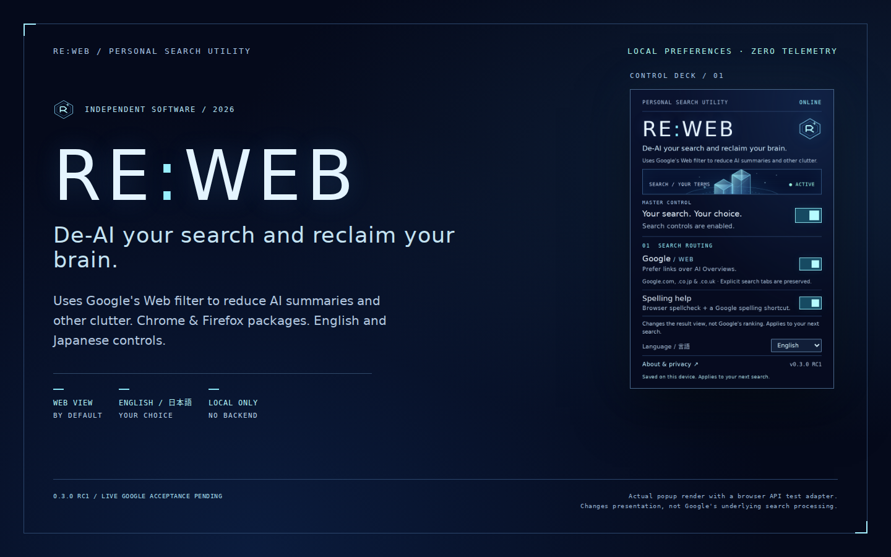

# RE:WEB

**De-AI your search and reclaim your brain.**

Uses Google's Web filter to reduce AI summaries and other clutter.

A small, free extension for desktop **Chrome and Firefox**, with a PS2-inspired control deck, a master pause switch, spelling help and **English / 日本語**. English is the default on every device; Japanese is an explicit, locally saved choice.

[日本語の説明](README.ja.md) · [Installation & troubleshooting](docs/INSTALL.md) · [Privacy](PRIVACY.md) · [Testing](docs/TESTING.md)



**Version 0.3.0 RC1.** Browser-specific packages are provided. Native installation/API checks now pass in both browsers on [GitHub Actions](https://github.com/DavidACook/Self-Development-Projects/actions/runs/40083244745): **52 Chrome checks and 43 Firefox checks**. Code, interface, spelling-fixture and manifest results are recorded in [test evidence](docs/TESTING.md). Live Google pages and native dictionary behavior still need manual acceptance; this is not a store-signed stable release.

## Download and install

| Browser | Package | Local installation |
| --- | --- | --- |
| Chrome 120+ | [Chrome ZIP](downloads/RE-WEB-v0.3.0-rc1-chrome.zip) | Unzip → `chrome://extensions` → Developer mode → Load unpacked → select the folder containing `manifest.json`. |
| Firefox 140+ desktop | [Firefox ZIP](downloads/RE-WEB-v0.3.0-rc1-firefox.zip) | Unzip → `about:debugging#/runtime/this-firefox` → Load Temporary Add-on → select `manifest.json`. Removed when Firefox closes. |

[Source archive](downloads/RE-WEB-v0.3.0-rc1-source.zip) · [SHA-256 checksums](downloads/SHA256SUMS.txt)

Firefox normally requires **Mozilla signing for a permanent installation**, including self-distribution. Renaming a ZIP to `.xpi` does not sign it. This repository supplies an unsigned development candidate and documents the [signing/release process](docs/RELEASE.md); it does not disable Firefox security settings or claim an AMO listing. Chrome Web Store publication is also separate.

When using source: Chrome can load **`extension/`** directly. For Firefox run `python3 scripts/build.py` and load **`dist/firefox/manifest.json`**. Both generated directories are dependency-free; npm is only for development tests and linting.

## How it works

- Requests Google's **Web** view (`udm=14`) for ordinary top-level GET searches on Google `.com`, `.co.jp` and `.co.uk` (apex and `www`).
- Preserves every explicit `udm`/`tbm` mode, including Images, Shopping, Videos and AI Mode. Maps and other paths are outside the redirect rules.
- Preserves query values, language, SafeSearch, pagination, date filters and duplicate parameters when routing.
- A master switch pauses routing **and spelling help**. Google routing and spelling help also have independent switches.
- Saves four preferences locally: master state, Google Web state, spelling-helper state and interface language. No backend, accounts, analytics, query logs or automatic spelling requests.

The browser evaluates two declarative redirect/allow rules. The background code does not receive search requests. A small Google-only content script provides the optional spelling feature described below; it does not hide results or AI modules with fragile DOM selectors.

## Spelling help

Enabled by default. On supported Google home/search pages, RE:WEB sets the search field's `spellcheck` hint to `true`, including when Google replaces the field. This lets an enabled browser dictionary offer underlines and right-click suggestions. It cannot install a dictionary or turn on spellchecking in browser settings. Japanese text entry uses your usual IME; Japanese grammar correction is not provided.

On Web results, a visible **Check spelling on Google** link opens the current query in Google's **All** view in a new tab (`udm=0`, an explicit routing override). It uses the currently typed search text, keeps language/region/SafeSearch and omits pagination/verbatim filters. A visible notice explains that **All can show AI elements**. RE:WEB makes no second search until you click the link. Google's own spelling/correction banners are left intact.

**Google decides when to show “Did you mean?”.** There is no supported setting here that guarantees Google's native spelling banner on every Web search. The shortcut provides access to Google's ordinary search experience; it is not an independent spelling engine. See [spelling limitations and setup](docs/SPELLING.md).

Turning off spelling help (or pausing RE:WEB) removes its link and restores the original `spellcheck` attribute in already-open tabs where the helper is running. After updating, reload existing Google tabs once to load the new helper. Removing/disabling an extension stops its scripts; reload a page to clear any already-applied DOM changes.

## English and Japanese

Open the toolbar popup → **Language / 言語** → **日本語**. All controls, accessible labels, status/error messages, About/privacy text and the on-page spelling link switch language. Return to **English** from the same selector, including while RE:WEB is paused. Switching interface language never changes Google's result language or your query. Extension metadata uses standard English/Japanese locale catalogs and follows the browser's metadata locale independently of the default-English popup.

| Target | Status / scope |
| --- | --- |
| Chrome 120+ desktop | Manifest V3 module service worker. Native installation, routing, storage and popup suite passed in GitHub CI; live Google acceptance pending. |
| Firefox 140+ desktop | Manifest V3 module background scripts, native `browser` APIs, stable add-on ID and no-data-collection declaration. Separate Firefox package; native installation/API/popup suite passed in CI; official `web-ext` lint has zero warnings/errors. |
| Google `.com`, `.co.jp`, `.co.uk` | HTTP/HTTPS, apex/`www`; other country domains are not requested. |
| Other engines, mobile, Edge, incognito, managed browsers | Outside verified release scope. |

## Honest limits

Google describes Web as text links without features such as AI Overviews. RE:WEB requests that view; it does not restore an old Google engine or remove AI from ranking/data processing. Ads can remain. Google's opt-in **Web Guide** experiment uses AI inside the Web tab; leave that Search Labs experiment if you want standard Web results.

`udm=14` and `udm=0` are site URL conventions, not a guaranteed API. Google can change them, its layout or its spelling behavior. [Primary-source research](docs/RESEARCH.md) separates provider documentation from implementation assumptions. Live Google acceptance in the development browser was blocked by an unusual-traffic CAPTCHA; no bypass was attempted.

Routing applies to subsequent network navigations. It does not rewrite a currently open URL or all same-document site navigation. Pause RE:WEB before a fresh search if you want normal All results. Explicitly selecting another tab is respected. Google still receives searches, including any spelling shortcut you choose to open.

## Privacy and permissions

Only `storage`, `declarativeNetRequestWithHostAccess` and six exact Google host patterns are requested. The spelling script reads the Google search field/URL in that tab to create its link; it never sends query contents to the worker, storage, a log or an extension server. It does not read result text. Browser spellchecking follows your browser's privacy settings; enhanced/cloud spellchecking can send text to the browser provider.

There is no history, cookies, tabs, clipboard or arbitrary-site access. All fonts, scripts and images are bundled/system-provided. Extension pages prohibit network connections with CSP. [Full privacy statement](PRIVACY.md) · [Architecture](docs/ARCHITECTURE.md).

## Development

Node **22+**, Python **3.10+**. No production npm dependencies.

```sh
npm ci
npm test                    # Settings, routing, localization, controller and background
npm run check               # Both manifests, syntax, locales, CSP and assets
npm run lint:firefox         # Official Mozilla validator; warnings fail
npx playwright install chromium
npm run test:ui             # Popup with a test adapter, including Japanese
npm run test:spelling       # Production content script on local fixtures
npm run build               # dist/chrome and dist/firefox
npm run test:browser        # Actual Chrome extension/DNR suite; local fixtures
python3 -m pip install -r requirements-dev.txt
npm run test:firefox         # Real Firefox install/API suite; Firefox + geckodriver needed
npm run package             # Both ZIPs, source archive and checksums
```

`REWEB_CHROME_PATH` selects a full Chrome for Testing executable. `REWEB_UI_CHROME_PATH` can select the renderer executable. `REWEB_FIREFOX_PATH`/`REWEB_GECKODRIVER_PATH` select local Firefox/geckodriver. Renderer tests use a test adapter and do not prove installation. Firefox API tests install the original package first, then a temporary, instrumented copy with unchanged production JavaScript/CSS; its test-only scripts report synthetic outcomes to localhost. [Testing details](docs/TESTING.md).

## Documentation and source

| Path | Purpose |
| --- | --- |
| `extension/lib/rules.js` | RE2-compatible redirect and explicit-mode rules |
| `extension/lib/settings.js`, `controller.js` | Validated preferences, serialized saves and rollback |
| `extension/lib/api.js`, `background.js` | Chrome/Firefox API selection and trusted extension-page messages |
| `extension/lib/i18n.js`, `_locales/` | English/Japanese interface strings and browser metadata |
| `extension/content/spelling.*` | Google-only spellcheck hint and spelling shortcut |
| `manifests/firefox.json`, `scripts/build.py` | Firefox manifest overrides and reproducible browser builds |
| `tests/`, `scripts/`, `docs/evidence/` | Regression suites, browser checks, validation and recorded results |
| [Install](docs/INSTALL.md), [Spelling](docs/SPELLING.md), [Release](docs/RELEASE.md) | Setup, troubleshooting, distribution and manual acceptance |
| [Architecture](docs/ARCHITECTURE.md), [Privacy](PRIVACY.md), [Research](docs/RESEARCH.md) | Design, data handling, constraints and primary sources |

MIT licensed. Original artwork and CSS; no Sony or PlayStation assets. Not affiliated with Google, Mozilla or Sony. [Changelog](CHANGELOG.md) · [Contributing](CONTRIBUTING.md).
