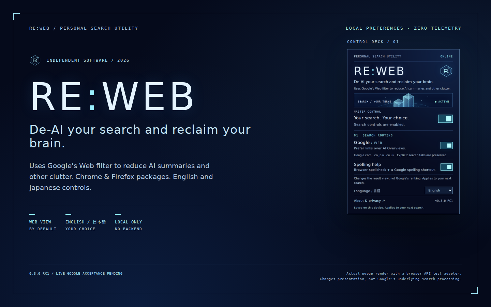

# RE:WEB

**De-AI your search and reclaim your brain.**

RE:WEB is a free browser extension that opens ordinary Google searches in the **Web** results view. I made it for anyone who wants to start with links instead of an AI summary.

It doesn't replace Google or change how Google ranks pages. It simply selects Google's existing Web view for you.



[日本語](README.ja.md) · [Installation help](docs/INSTALL.md) · [Privacy](PRIVACY.md) · [Test results](docs/TESTING.md)

## Install

**Current build: 0.3.0 RC1.** This is a development release, not a signed browser-store release.

| Browser | Download | How to load it |
| --- | --- | --- |
| Chrome 120+ (desktop) | [Chrome ZIP](downloads/RE-WEB-v0.3.0-rc1-chrome.zip) | Unzip, open `chrome://extensions`, enable Developer mode, then choose **Load unpacked** and select the folder with `manifest.json`. |
| Firefox 140+ (desktop) | [Firefox ZIP](downloads/RE-WEB-v0.3.0-rc1-firefox.zip) | Unzip, open `about:debugging#/runtime/this-firefox`, choose **Load Temporary Add-on**, then select `manifest.json`. |

Firefox removes temporary add-ons when it closes. A permanent Firefox installation normally needs Mozilla signing; this ZIP is not signed. See [installation help](docs/INSTALL.md) and [release notes](docs/RELEASE.md).

[Source ZIP](downloads/RE-WEB-v0.3.0-rc1-source.zip) · [SHA-256 checksums](downloads/SHA256SUMS.txt)

## What it does

- **Google Web by default.** Adds `udm=14` to ordinary searches on Google `.com`, `.co.jp` and `.co.uk` (including `www`), so the Web results tab opens automatically.
- **Leaves your choices alone.** If you select Images, Shopping, Videos, AI Mode or another search mode yourself, RE:WEB doesn't override it. It keeps your query and existing search parameters.
- **Easy to pause.** Switch everything off from the popup, or control Google Web routing and spelling help separately. Settings stay on your device.
- **Optional spelling help.** Uses your browser's spelling checker in Google's search box and offers a link back to Google's regular results when you want to check a query.
- **English and Japanese.** The interface starts in English; you can choose 日本語 in the popup.

The interface takes inspiration from early-2000s console menus, but the artwork and code are original.

### A note on spelling

RE:WEB can enable the search box's `spellcheck` hint, but your browser still needs a suitable dictionary and spellchecking enabled. It cannot force Google's own "Did you mean?" suggestions to appear.

On Web results, **Check spelling on Google** opens the current query in Google's **All** results in a new tab. That view may contain AI features. Nothing is searched a second time unless you click the link. [More about spelling help](docs/SPELLING.md).

## What it doesn't do

RE:WEB is a shortcut to Google's Web view, not an AI blocker for Google's ranking or data processing. Ads may still appear. Google's optional Web Guide experiment can also introduce AI into the Web tab. Google may change its search URLs or page behaviour at any time.

It currently targets desktop Chrome and Firefox on the listed Google domains. Other search engines, Edge, mobile and incognito use are outside the verified release scope.

## Privacy

No account, analytics, query history or extension server. RE:WEB saves only four local preferences: whether it's enabled, whether Google Web routing is on, whether spelling help is on, and your interface language.

The spelling helper runs on the supported Google pages and reads the search field only to show its optional link. It doesn't store your query or send it to the extension's background code. Your searches still go to Google, and browser-provided cloud spellchecking may send text under your browser's own settings.

[Read the full privacy statement](PRIVACY.md).

## Current testing status

Native installation and extension-API checks passed in GitHub Actions: **52 Chrome checks and 43 Firefox checks** ([CI run](https://github.com/DavidACook/Self-Development-Projects/actions/runs/40083244745)). Automated source, interface, manifest and spelling-fixture tests are also documented.

**Still to verify manually:** behaviour on live Google result pages and with real browser dictionaries. The development browser encountered a Google CAPTCHA, so those checks have not been claimed as passing. Store submission and Firefox signing are also outstanding.

See [test evidence](docs/TESTING.md) and the [changelog](CHANGELOG.md) for details.

## Build and contribute

Requires **Node.js 22+** and **Python 3.10+**. There are no production npm dependencies.

```sh
npm ci
npm test           # Unit/regression tests
npm run check      # Manifests, syntax, locales and assets
npm run build      # Chrome and Firefox builds
```

For browser tests, Firefox validation and packaging, see [testing](docs/TESTING.md), [architecture](docs/ARCHITECTURE.md) and [contributing](CONTRIBUTING.md). Chrome can also load `extension/` directly; Firefox should use the generated `dist/firefox/` build.

MIT licensed. Not affiliated with Google, Mozilla, Sony or PlayStation.
